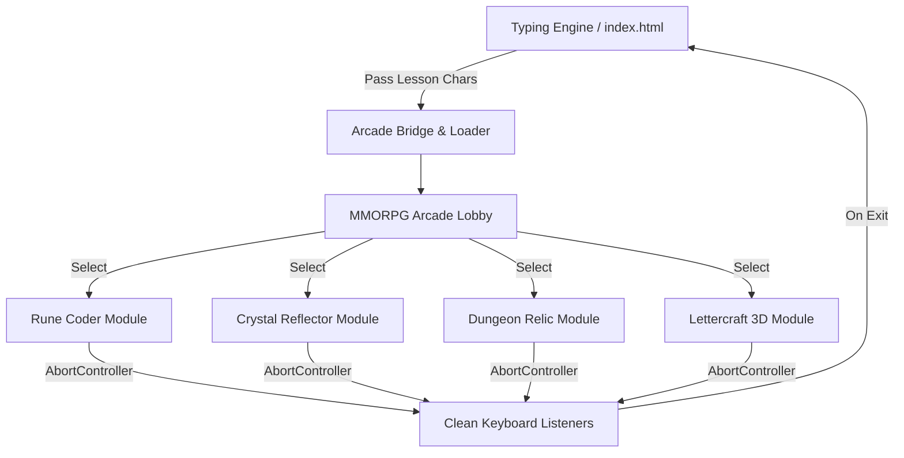

# Design Spec: MMORPG Puzzle Arcade (Tri-Input Keyboard Learning)

## 1. Overview
The **MMORPG Puzzle Arcade** is an educational mini-game suite integrated into the NextGen Typing application. It engages students after completing a typing lesson by immersing them in a retro fantasy RPG world.

The core learning innovation is the **Tri-Input Coordination System**:
1. **Arrow Keys (`↑ ↓ ← →`)**: Develop spatial awareness, navigation, and algorithmic direction planning (Right-hand control).
2. **Lesson Letter Keys (`chars` from current lesson)**: Reinforce touch typing and muscle memory for the specific characters practiced in that lesson.
3. **Space bar (`Space`)**: Train thumb coordination for executing code batches, jumping/actions, and rotating prisms.

---

## 2. The 3 MMORPG Puzzle Games

### Game 1: "Rune Coder: วงกตศิลาจารึกเวทมนตร์" (Scratch-Style Algorithm Puzzle)
* **Theme**: The hero is in an ancient dungeon filled with traps, locked spell-doors, and goal portals.
* **Tri-Input Mechanics**:
  - **Arrow Keys (`↑ ↓ ← →`)**: Build an ordered program queue of movement commands:
    - `↑`: Step Forward 1 tile
    - `↓`: Step Backward 1 tile
    - `←`: Turn Left 90°
    - `→`: Turn Right 90°
  - **Lesson Letter Keys (`chars`)**: When encountering a "Rune Barrier Door" or "Spell Gate", the student inserts a spell-cast command by typing the matching character from their current lesson into the sequence (e.g. `[Step Forward] -> [Cast 'ก'] -> [Turn Right] -> [Step Forward]`).
  - **Space bar**: **"Execute Program (รันโปรแกรม / ธงเขียว)"** — Triggers the adventurer to execute the entire command sequence step-by-step with smooth animations and magic particles.
* **Pedagogical Outcome**: Algorithmic thinking, decomposition, predictive sequencing, and debugging (if execution fails or hits a wall, student presses Space to reset and adjust commands).

---

### Game 2: "Crystal Reflector: หอคอยกระจกสะท้อนแสง" (Optics & Trigger Strategy)
* **Theme**: A wizard's chamber where sacred laser beams must be redirected through prisms to illuminate rune monoliths.
* **Tri-Input Mechanics**:
  - **Arrow Keys (`↑ ↓ ← →`)**: Move the adventurer freely across the grid chamber in real time.
  - **Space bar**: When adjacent to a crystal prism, pressing Space rotates the prism angle (45° / 90°) to deflect the light path.
  - **Lesson Letter Keys (`chars`)**: When a redirected laser strikes a "Rune Obelisk", the obelisk glows. The student must press the matching lesson key on their keyboard to energize the pillar and fire the next beam segment toward the final portal!
* **Pedagogical Outcome**: Trajectory prediction, geometry intuition, and instant letter-key reaction.

---

### Game 3: "Dungeon Relic: ผลักหีบสมบัติวงเวท" (Sokoban Strategic Push)
* **Theme**: An ancient treasure vault where rune-inscribed relic chests must be pushed onto matching magic circles on the floor.
* **Tri-Input Mechanics**:
  - **Arrow Keys (`↑ ↓ ← →`)**: Walk and push relic chests across the floor grid.
  - **Lesson Letter Keys (`chars`)**: Each chest is bound by a runic chain labeled with a lesson character. When the player approaches a chest, they must press the matching letter key to unlock the chain before it can be pushed. When pushed onto the magic circle, they press the letter again to seal it into place!
  - **Space bar**: **"Vault Jump / Undo (เคาะข้าม / ย้อนก้าว)"** — Pressing Space allows the hero to leap over an obstacle or undo the last push if a chest is accidentally trapped against a corner.
* **Pedagogical Outcome**: Spatial foresight, deadlock avoidance, and keyboard letter recall.

---

## 3. MMORPG Dungeon Lobby & Selection Menu
* **Trigger**: After achieving ≥ 80% accuracy in a typing lesson, the completion modal displays:
  `[ 🎮 สำรวจดันเจี้ยนปริศนา (MMORPG Arcade) ]`
* **Lobby Interface**:
  - Styled with gold borders, stone dungeon frames, health bars, and retro pixel-art aesthetic.
  - Displays 4 selectable options:
    1. **⚔️ Rune Coder** (เขาวงกตโค้ดดิ้ง)
    2. **🔮 Crystal Reflector** (หอคอยกระจกสะท้อนแสง)
    3. **📦 Dungeon Relic** (ผลักหีบสมบัติโบราณ)
    4. **🌲 Lettercraft 3D** (นักสำรวจ 3 มิติดั้งเดิม)
  - Shows preview badge, difficulty level, and controls guide for each game.

---

## 4. Strict Isolation Architecture (Zero Side Effects Guarantee)

1. **Independent Module Directory (`src/arcade/`)**:
   - `src/arcade/core.js`: Game logic, grid maps, character state, collision, and victory conditions.
   - `src/arcade/view.js`: 2D Canvas / HTML5 rendering for retro MMORPG dungeon tiles, hero sprite, particle bursts, and animations.
   - `src/arcade/bridge.js`: Connects lesson characters (`curriculum[lang][index].chars`) to the puzzle generation.
   - `src/arcade/style.css`: Retro fantasy RPG styling.
2. **Isolated Input Lifecycle**:
   - Keydown event listeners for Arrow Keys, Spacebar, and Letters are scoped strictly to the arcade session using an `AbortController`.
   - When the player exits back to the typing lesson, all arcade event listeners are cleanly aborted, and focus is returned to the typing input.
3. **No Database / State Pollution**:
   - Lesson progress, user accounts, and Google Apps Script sync are completely untouched.

---

## 5. Verification & Testing Strategy
* **Unit Tests (`tests/arcade-puzzle.test.cjs`)**:
  - Test command queue execution and collision for Rune Coder.
  - Test laser deflection math and pillar energizing for Crystal Reflector.
  - Test grid push mechanics, chain unlock, and undo history for Dungeon Relic.
  - Test dynamic injection of lesson characters into grid targets.
* **Zero-Regression Assurance**:
  - Run all 62 existing unit tests (`node --test tests/*.test.cjs`).
  - Verify syntax and asset bundling.
